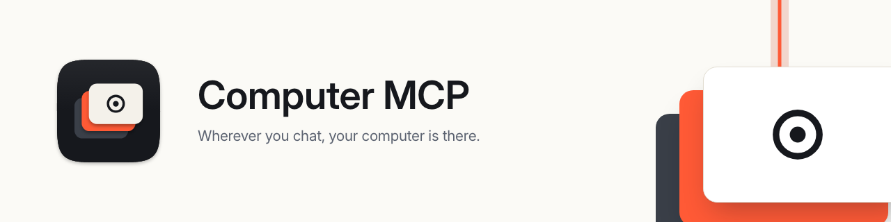

<picture>
  <source media="(prefers-color-scheme: dark)" srcset="Documentation/Brand/header-dark.png">
  
</picture>

# Computer MCP

**Wherever you chat, your computer is there.**

Connect local tools directly to ChatGPT or another compatible MCP client.
Compose typed capabilities, CLI tools, MCP servers, Skills and Computer Use
across your computers, with access governed on each host. Codex is an optional
integration.

[Get started](#quick-start) · [Product site](https://computer-mcp.github.io/) ·
[Documentation](Documentation/README.md) ·
[Latest release](https://github.com/computer-mcp/computer-mcp/releases/latest) ·
[简体中文](README.zh-CN.md)

- **Put your CLI tools to work.** Register commands or install a CLI plugin so
  ChatGPT can invoke exposed tools and read their results.
- **Code with Codex from your conversation.** Use the independent Codex plugin
  to start coding tasks, follow progress and inspect results.
- **Connect more with MCP and Skills.** Add MCP services and reusable instructions
  directly or together in a plugin package.
- **Work across computers.** Connect each host, select its project, and use
  tools in that computer's environment.
- **Choose the access.** Configure tools, projects and confirmation policy;
  review host actions requiring approval locally.

Computer MCP runs on macOS 14 or later and supports ChatGPT and other compatible
MCP clients. Tools need installation and configuration, as described in each
plugin's documentation. Skills
provide instructions and resources, while execution uses authorized tools.

## The 30-second model

```text
ChatGPT · Codex · another MCP client
                 │
       authenticated connection
                 ▼
          Computer MCP.app
                 │
 caller → profile → registered project → policy → approval when required
                 │
                 ▼
 Builtin · Skills · CLI · MCP · AX fallback · Git · Shell
                 │
                 ▼
       local execution → bounded result → redacted audit receipt
```

Every call is tied to a caller, profile, capability, and—when relevant—a
registered project. Unknown tools, ungranted projects, unsafe paths, and
unsupported ownership claims fail closed.

Each host keeps its own credentials, registrations, approvals and audit.
Project IDs belong to that host; connecting several computers does not share
their files or move running processes. See
[Product Identity](Documentation/Architecture/ProductIdentity.md).

## Plugins and direct integrations

A plugin is a package combining MCP, CLI and Skills contributions. Native MCP
servers and local CLI/Skill registrations can also be added directly; both
paths use the same host policy, project scope and audit.

Use the App's plugin management pages, or the owner CLI:

```sh
computer-mcp plugins search --refresh
computer-mcp plugins list
```

Official packages include [Codex](https://github.com/computer-mcp/plugin-codex),
[Computer Use](https://github.com/computer-mcp/plugin-computer-use),
[Claude Code](https://github.com/computer-mcp/plugin-claude),
[Cursor](https://github.com/computer-mcp/plugin-cursor),
[Swift Format](https://github.com/computer-mcp/plugin-swift-format) and
[TRAE](https://github.com/computer-mcp/plugin-trae) (repository access required). Select a
release artifact to install, review its dependencies and tool exposure, then
enable it. Installation starts disabled and grants no permissions. Bundled
packages use the same lifecycle; external tools remain user/vendor-owned.

Native Computer Use also depends on vendor caller authentication, not just
macOS privacy grants; native AX tools remain available as fallback.

See [Plugin Packages](Documentation/Reference/PluginPackages.md) for installation,
upgrades and recovery, and [CLI Trees](Documentation/Reference/CLITrees.md) for
verified command projection and structured-coverage limits.

## What it enables

- Ask ChatGPT to inspect a local project, use connected research tools, and hand
  implementation work to Codex.
- Run a registered formatter, inspect a Git diff, or process files through
  authorized local commands, then use the result in the next step.
- Deliver scoped text edits through `delivery.scopes.list` and `delivery.apply`,
  using isolated Git worktrees and recoverable commit/land operations. Configure
  `[[delivery.scopes]]` in the App-managed or standalone manifest; see
  [Isolated delivery](Documentation/Reference/Delivery.md).
- Combine CLI commands, downstream MCP services and reusable Skills around a
  task through one gateway.
- Connect from ChatGPT through Secure MCP Tunnel or from a reviewed remote
  client through a Cloudflare named tunnel, subject to client and account support.
- Connect desktop operations through the Computer Use plugin or native AX tools,
  subject to operation-specific macOS permissions and vendor caller authentication.

## Choose what your agents can use

Computer MCP makes two separate decisions:

1. **Policy authorization:** Is this caller allowed to use this capability in
   this registered project at all?
2. **Action consent:** If host policy requires confirmation, has the local user
   approved this exact operation?

In the App's **Client access** page, review connected clients and explicitly
grant Full Access, defaulting to **This Session**. Full Access permits arbitrary
execution as your macOS user; projects provide project context, not a sandbox.
**Always Allow this Client** is a separate choice. You can downgrade or end a
connection's access and separately revoke saved client approvals. Access changes
apply to new requests without cancelling work already started. The local
`computer-mcp clients` commands provide the same access controls; see
[Client access](Documentation/Reference/CLI.md#client-access) for explicit
consent and standalone HTTP usage.

On an App-managed connection, approved Full Access also enables typed project
management and verified official plugin installation, configuration and updates.
Clients use these tools directly while existing work continues; see
[Remote management](Documentation/Reference/ControlPlaneCapabilities.md#remote-management).

Choose **restricted permissions** to select readable capabilities, projects and
integrations, and the connection types allowed to use them. These defaults apply
to clients sharing the profile; each session can impose a lower access level.
Saving a selection invalidates previous Full Access approvals for that profile.

An individual action confirmation never expands the client's current access.
Restricted Access uses its selected tools and projects and prohibits arbitrary
execution. Credentials stay in the signed App's macOS Data Protection Keychain;
examples, diagnostics, logs, and audit rows keep only placeholders or redacted
summaries.

Plugin execution settings and runtime permissions are documented by each plugin.
Callbacks into Computer MCP require the corresponding host capabilities and
local confirmation.

See [Security and Privacy](Documentation/Architecture/SecurityAndPrivacy.md) for
the complete trust model and [SECURITY.md](SECURITY.md) for reporting a
vulnerability.

## Capability status

| Status | Capability | Notes |
| --- | --- | --- |
| Stable | App-owned local gateway, project registration, profiles, policy, operation tickets, and redacted audit | Default product control plane on macOS 14+ |
| Stable | Local MCP, ChatGPT through OpenAI Secure MCP Tunnel, and Cloudflare named-tunnel connections | Each remote path has its own caller and profile boundary |
| Stable | Builtin, Skill, registered CLI, downstream MCP, Shell, and native AX fallback | Availability still depends on the selected profile, project, dependency, and macOS permission |
| Stable | Governed project and Git operations | Writes require policy; destructive atomics use reviewed single-use tickets; no implicit push |
| Stable | Plugin package lifecycle, direct/plugin MCP registration, verified CLI trees and Skills | Host grants remain separate; external dependencies are not installed automatically |
| Planned | Broader platform support and more first-class UI for advanced orchestration | No committed release date; the current signed App is macOS-only |

## ChatGPT orchestrates, Codex executes

ChatGPT can inspect a registered project and delegate coding work through the
[Codex plugin](https://github.com/computer-mcp/plugin-codex). The host governs tool access, project grants, approvals and
audit. The plugin owns coding execution and its runtime lifecycle.

## Computer MCP, Dots and Codex Remote

| Choose | When the job is |
| --- | --- |
| **Computer MCP** | Direct, composable, governed access to general local capabilities across computers and compatible MCP clients |
| **OpenAI Dots** | Always-on cloud-agent work with memory, apps and proactive follow-through; one connected personal computer at a time |
| **Codex Remote** | First-party remote coding: start, steer, approve and review Codex tasks across connected computers |

Computer MCP does not require a Codex task for ordinary registered tools. Each
host executes its own capabilities. Dots also has a separate cloud computer;
Codex Remote runs coding tasks on the selected connected host. Account and
service usage terms still apply. The
[full comparison](https://computer-mcp.github.io/#comparison) covers
interfaces, execution and authority, with official OpenAI sources checked on
2026-10-01.

## Quick start

Computer MCP requires macOS 14 or later.

1. Download the notarized Universal 2 DMG and `SHA256SUMS` from the
   [latest release](https://github.com/computer-mcp/computer-mcp/releases/latest),
   or install with Homebrew and skip to opening the App:

   ```sh
   brew install --cask computer-mcp/tap/computer-mcp
   ```

2. Verify the checksum, drag **Computer MCP** to Applications, and open the
   installed App from Finder. macOS privacy grants belong to this signed App
   identity.
3. On Welcome, choose **Connect a local MCP client** and start the Gateway.
4. On Home, choose **Connect…** next to Codex, Claude Code or Claude Desktop,
   review the change and confirm. Quit Claude Desktop before confirming its
   change. The [registration commands](Documentation/Reference/CLI.md#local-client-registration)
   do the same from a terminal.
5. Make the first read-only tool call:

   ```text
   project.list
   ```

6. Refresh Home. The connection becomes Verified only after a matching,
   successful audit event is observed.

Optionally install the bundled CLI from Home. It creates
`~/.local/bin/computer-mcp` without `sudo`. Check the same live readiness model
from a terminal:

```sh
computer-mcp doctor --journey local
computer-mcp doctor --journey local --json
```

Doctor exits 0 only for Ready or Verified. Its schema-1 JSON remains parseable
when the App is unavailable and never includes a credential value.

Continue with the [Quick Start](Documentation/Reference/QuickStart.md),
[ChatGPT runbook](Documentation/Reference/ChatGPTWebRunbook.md), or
[Cloudflare runbook](Documentation/Reference/CloudflareRunbook.md). Normal App
use does not require TOML.

## Architecture

The App owns the gateway, private control socket, registered project
bookmarks, profiles, provider and tunnel lifecycles, Keychain credentials, and
audit database. Local clients use an owner-only Unix-domain socket. ChatGPT
uses OpenAI Secure MCP Tunnel. Reviewed public MCP consumers can use a
loopback-only, bearer-protected origin behind a Cloudflare remotely managed
named tunnel.

Cloudflare connections support optional OAuth for public CIMD clients such as
claude.ai. Turn on **Allow sign-in with OAuth** in the App's Cloudflare
connection editor, or use the owner CLI or manifest. When a client signs in,
compare the six-character pairing code on its browser page with the request in
**Client access**, choose its profile and approve; `computer-mcp clients
authorizations` and `computer-mcp clients authorize <code>` do the same from a
terminal. Grants default to Observe and retain the existing local Full Access
consent boundary. See the
[OAuth setup and revocation steps](Documentation/Reference/CloudflareRunbook.md#oauth-client-pairing).
Verified follows the current Access Token or a live OAuth grant; replacing or
revoking that credential requires fresh verification for its replacement.

The gateway then resolves the exact tool, binds caller/profile/project,
checks policy and any operation ticket, obtains action consent when needed,
dispatches one bounded adapter, and records the redacted outcome. Standalone
TOML modes are development and diagnostic surfaces; they do not share the
App's bookmarks or Keychain state.

Read the current architecture in [Gateway](Documentation/Architecture/Gateway.md),
[Runtime](Documentation/Architecture/Runtime.md), and
[Capability Ownership](Documentation/Architecture/Ownership.md). Exhaustive
commands and schemas belong in [Reference](Documentation/Reference/README.md).

## Current limitations

- The signed product is macOS-only and requires macOS 14 or later.
- Remote setup depends on user-owned OpenAI or Cloudflare services and their
  current account, administrator, network, and availability constraints.
- Accessibility and Screen Recording must be granted to the installed signed
  App for capabilities that need them; other capabilities remain available.
- Computer MCP does not silently select a project when more than one eligible
  project exists, does not implicitly push Git commits.
- A development build or ad-hoc-signed App is not an official release and does
  not inherit the installed release's macOS privacy or Keychain identity.

## Documentation map

- [Documentation home](Documentation/README.md)
- [Quick Start](Documentation/Reference/QuickStart.md)
- [CLI reference](Documentation/Reference/CLI.md)
- [Configuration reference](Documentation/Reference/Config.md)
- [Tool reference](Documentation/Reference/Tools.md)
- [Troubleshooting](Documentation/Reference/Troubleshooting.md)
- [Architecture](Documentation/Architecture/README.md)
- [Security and privacy](Documentation/Architecture/SecurityAndPrivacy.md)
- [Versioning rules](VERSIONING.md)
- [Release process](Documentation/Reference/Release.md)

## Development and contributing

Inspect [Package.swift](Package.swift) before changing products or targets.
Build and test from the repository root:

```sh
swift-format lint --strict --recursive --configuration .swift-format Package.swift Sources Tests
/usr/bin/swift build
/usr/bin/swift test
```

For standalone development, use one explicit TOML file per process:

```sh
swift run computer-mcp serve stdio --config Examples/computer-mcp.toml
swift run computer-mcp config validate --config Examples/computer-mcp.toml
swift run computer-mcp tools list --config Examples/computer-mcp.toml
```

Standalone mode does not use App-owned bookmarks, database state, or Keychain
tunnel credentials and must not run as a second owner of the App's state. See
[Examples](Examples/README.md) and [CONTRIBUTING.md](CONTRIBUTING.md) before
opening a change.

Official releases start from an exact trusted-master candidate commit. The
protected workflow verifies source, builds, Developer ID signs, notarizes,
staples, creates the signed tag and publishes the same candidate bytes in GitHub
Actions. The website synchronizes public delivery automatically. See
[Release Reference](Documentation/Reference/Release.md).

Computer MCP is licensed under the
[Functional Source License 1.1, Apache 2.0 Future License](LICENSE)
(FSL-1.1-ALv2): any use other than a competing product or service is
permitted, and each release becomes available under Apache-2.0 two years after
publication. Official executable releases also come with the
[End-User License Agreement](EULA.md).
